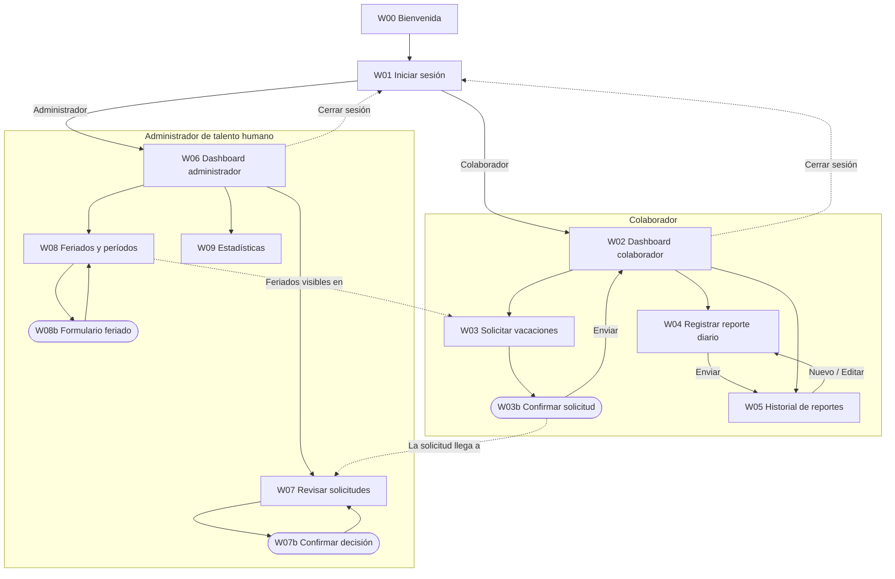

# Wireframes – Rikimaka

Documento de apoyo a los wireframes del Avance I.

**PDF:** [`wireframes-rikimaka.pdf`](wireframes-rikimaka.pdf) (22 páginas)
**Flujo de navegación editable:** [`diagrams/flujo-navegacion.drawio`](diagrams/flujo-navegacion.drawio) (se abre en [draw.io](https://app.diagrams.net))

## Contenido del PDF

| Página | Contenido |
|---|---|
| 1 | Portada |
| 2 | Índice y cobertura de la rúbrica |
| 3 | Proceso de diseño: pasos, iteraciones y decisiones |
| 4 | Leyenda de símbolos |
| 5 | Componentes y estilos (botones, campos, estados, tipografía, colores, grid) |
| 6–7 | W00 Bienvenida · W01 Iniciar sesión (comunes) |
| 8–12 | W02–W05 y W03b (Colaborador) |
| 13–18 | W06–W09, W07b y W08b (Administrador de talento humano) |
| 19 | Flujo de navegación |
| 20 | Tabla de conexiones |
| 21 | Procesos del negocio: vacaciones y reporte diario, con su resultado |
| 22 | Resultado final: las 13 pantallas en una vista general |

## Funcionalidades cubiertas

| # | Funcionalidad | Rol | Pantallas |
|---|---|---|---|
| F1 | Panel personal | Colaborador | W02 |
| F2 | Solicitar vacaciones | Colaborador | W03, W03b |
| F3 | Registrar reporte diario | Colaborador | W04 |
| F4 | Historial de reportes | Colaborador | W05 |
| F5 | Panel administrativo | Administrador de talento humano | W06 |
| F6 | Aprobar o rechazar vacaciones | Administrador de talento humano | W07, W07b |
| F7 | Gestionar feriados y períodos | Administrador de talento humano | W08, W08b |
| F8 | Estadísticas y reportes | Administrador de talento humano | W09 |

Las pantallas del personal de TI (catálogo de proyectos, asignaciones y usuarios) se diseñarán en el Avance II.

## 1. Fichas por pantalla

Cada página del PDF muestra la ficha (código, título, rol y objetivo), la pantalla a 1440 px y, a la derecha, las anotaciones numeradas y la navegación.

---

### W00 – Bienvenida
- **Rol:** Común (público)
- **Objetivo:** Presentar el sistema y llevar al usuario a iniciar sesión.
- **Tamaño:** 1440 × 2400

**Disposición**
1. Encabezado (12 col, alto 80): logo a la izquierda (3 col) · menú "Funcionalidades", "Roles", "Ayuda" (6 col) · botón primario a la derecha (3 col).
2. Hero (12 col, alto 720): `Placeholder video` a sangre completa con capa oscura. Texto alineado a la izquierda (6 col). Tarjeta flotante (4 col) a la derecha.
3. Franja de cifras (12 col, 3 bloques de 4 col).
4. Sección "ROLES DEL SISTEMA" (12 col, 3 tarjetas de 4 col).
5. Banda de beneficios (12 col, fondo `Gris/100`, cuadrícula de 3 × 2).
6. Footer (12 col, 4 columnas de 3 col).

**Elementos**
| Tipo | Texto exacto | Componente |
|---|---|---|
| Enlace de salto | "Saltar al contenido principal" | Botón texto (visible al recibir foco) |
| Logo | "RIKIMAKA" | Texto H3 |
| Botón | "Iniciar sesión" | Botón primario |
| Titular | "Gestiona tu talento, proyectos y tiempo en un solo lugar" | H1 (56px en este caso) |
| Subtítulo | "Vacaciones, reportes diarios y estadísticas para todo tu equipo." | Cuerpo |
| Botón | "Pausar fondo" | Botón secundario pequeño, esquina inferior izquierda del hero |
| Tarjeta flotante: título | "Bienvenido a Rikimaka" | H3 |
| Tarjeta flotante: botones | "Iniciar sesión" · "¿Qué puedo hacer en Rikimaka?" | Primario · Texto |
| Cifras | "+120 colaboradores" · "35 proyectos activos" · "98 % reportes al día" | H1 + Etiqueta |
| Título de sección | "ROLES DEL SISTEMA" + enlace "Ver todas las funcionalidades" | H2 + Botón texto |
| Tarjetas | "Colaborador" · "Talento humano" · "Personal de TI", cada una con el botón "CONOCER MÁS" | Tarjeta con imagen |
| Título de sección | "BENEFICIOS" | H2 |
| Beneficios | "Vacaciones sin papeleo" · "Reportes en 2 minutos" · "Feriados siempre visibles" · "Estadísticas en tiempo real" · "Accesible para todas las personas" · "Funciona en cualquier dispositivo" | Ícono + Etiqueta |
| Footer | Columnas: "Sistema", "Ayuda" (Glosario, Mapa del sitio, Contacto), "Accesibilidad" (Declaración de accesibilidad), "Síguenos" | Texto |

**Anotaciones**
1. El enlace "Saltar al contenido principal" es el primer elemento enfocable.
2. El video es decorativo y no tiene audio; con `prefers-reduced-motion` se muestra la imagen póster.
3. El botón "Pausar fondo" detiene y reanuda el video y cambia su texto a "Reproducir fondo".
4. La capa oscura garantiza un contraste de 7:1 en el titular.
5. Los títulos de sección van en MAYÚSCULAS por CSS (`text-transform`), no escritos así en el HTML.

**Conexiones**
| Elemento | Destino |
|---|---|
| "Iniciar sesión" (encabezado y tarjeta) | W01 |
| "¿Qué puedo hacer en Rikimaka?" | Desplaza a "ROLES DEL SISTEMA" |
| "CONOCER MÁS" | W01 |

---

### W01 – Iniciar sesión
- **Rol:** Común
- **Objetivo:** Autenticar al usuario y llevarlo al dashboard de su rol.

**Disposición**
1. Columna izquierda (6 col, alto completo): `Placeholder imagen` con la frase "Tu tiempo, bien organizado." encima.
2. Columna derecha (4 col, centrada verticalmente, desplazada 1 col): formulario.

**Elementos**
| Tipo | Texto exacto | Componente |
|---|---|---|
| Enlace | "‹ Volver al inicio" | Botón texto |
| Logo | "RIKIMAKA" | H3 |
| Título | "Iniciar sesión" | H1 |
| Área de error | "No pudimos iniciar sesión. Revisa tu correo y contraseña." | Toast de error (en línea, arriba del formulario) |
| Campo | Etiqueta "Correo o identificación" · Ayuda "Ej.: nombre@rikimaka.com o 1-2345-6789" | Campo de texto |
| Campo | Etiqueta "Contraseña" + botón "Mostrar" | Campo de texto |
| Enlace | "¿Olvidaste tu contraseña?" | Botón texto |
| Botón | "Ingresar" | Botón primario (ancho completo) |
| Enlace | "¿Necesitas ayuda para ingresar?" | Botón texto |

**Anotaciones**
1. Los campos usan `autocomplete="username"` y `autocomplete="current-password"`.
2. Los errores se anuncian con `aria-live` y el foco se mueve al resumen de errores.
3. Sin límite de intentos por tiempo ni cierre de sesión por inactividad.
4. Al ingresar, se redirige según el rol: el Colaborador va a W02 y el Administrador a W06.

**Conexiones**
| Elemento | Destino |
|---|---|
| "Ingresar" (colaborador) | W02 |
| "Ingresar" (administrador) | W06 |
| "‹ Volver al inicio" | W00 |
| "¿Olvidaste tu contraseña?" | Recuperar contraseña (fuera de alcance de este avance; indícalo con una nota) |

---

### W02 – Dashboard del colaborador
- **Rol:** Colaborador
- **Objetivo:** Ver de un vistazo el estado personal y acceder a las tareas diarias.

**Disposición**
1. `Barra lateral` (240px), variante Colaborador, con el ítem "Inicio" activo.
2. `Encabezado` (12 col) con migas de pan "Inicio".
3. Saludo (12 col).
4. 4 `Tarjeta métrica` (3 col cada una).
5. Bloque "ACCESOS RÁPIDOS" (12 col, 2 botones grandes de 6 col).
6. Tabla "MIS PROYECTOS" (8 col) y lista "NOTIFICACIONES" (4 col).

**Elementos**
| Tipo | Texto exacto | Componente |
|---|---|---|
| Menú lateral | "Inicio" · "Vacaciones" · "Reportes diarios" · "Mis proyectos" · "Notificaciones" · "Ayuda" · "Cerrar sesión" | Barra lateral |
| Título | "Hola, [Nombre]" · subtítulo "Lunes 12 de octubre de 2026" | H1 + Cuerpo |
| Métricas | "12 días de vacaciones disponibles" · "32 h reportadas esta semana" · "3 proyectos asignados" · "1 solicitud pendiente" | Tarjeta métrica |
| Botones | "Registrar reporte de hoy" · "Solicitar vacaciones" | Primario · Secundario (altura 72) |
| Tabla | Columnas: "Código", "Proyecto", "Mi rol", "Horas este mes" | Tabla |
| Lista | 3 notificaciones + enlace "Ver todas las notificaciones" | Texto + Botón texto |

**Anotaciones**
1. La barra lateral marca la página actual con `aria-current="page"`.
2. Si hoy no hay reporte, aparece un aviso en texto: "Aún no has registrado tu reporte de hoy."
3. Las notificaciones no interrumpen: se revisan cuando el usuario quiera.

**Conexiones**
| Elemento | Destino |
|---|---|
| "Registrar reporte de hoy" / menú "Reportes diarios" | W04 |
| "Solicitar vacaciones" / menú "Vacaciones" | W03 |
| Menú "Reportes diarios" › "Historial" | W05 |
| "Cerrar sesión" | W01 |

---

### W03 – Solicitar vacaciones
- **Rol:** Colaborador
- **Objetivo:** Elegir fechas en un calendario que muestra feriados y períodos permitidos, y enviar la solicitud.

**Disposición**
1. Barra lateral (ítem "Vacaciones" activo) y encabezado con migas de pan "Inicio › Vacaciones › Nueva solicitud".
2. Título y descripción (12 col).
3. Calendario (8 col) con la leyenda debajo.
4. Panel de resumen (4 col).
5. Modal de confirmación (frame separado o superpuesto, `W03b`).

**Elementos**
| Tipo | Texto exacto | Componente |
|---|---|---|
| Título | "Solicitar vacaciones" | H1 |
| Descripción | "Selecciona el primer y el último día. Los fines de semana y feriados no se descuentan." | Cuerpo |
| Navegación de mes | "‹ Septiembre" · "Octubre 2026" · "Noviembre ›" | Botones texto + H3 |
| Calendario | Cuadrícula de 7 × 5; marca el 12 de octubre como feriado | Rectángulos |
| Leyenda | "▲ Feriado" · "▒ Período permitido" · "● Seleccionado" · "— No disponible" | Ícono + Etiqueta |
| Panel: campos | "Fecha de inicio" · "Fecha de fin" | Selector de fecha |
| Panel: datos | "Días hábiles solicitados: 5" · "Días disponibles: 12" · "Días restantes: 7" | Cuerpo |
| Panel: campo | "Comentario (opcional)" | Campo de texto (multilínea) |
| Botones | "Revisar solicitud" · "Cancelar" | Primario · Secundario |
| Modal: título | "Confirma tu solicitud" | H2 |
| Modal: resumen | Fechas, días hábiles y comentario | Cuerpo |
| Modal: botones | "Enviar solicitud" · "Volver a editar" | Primario · Secundario |
| Toast | "Solicitud enviada. Te avisaremos cuando sea revisada." + "Deshacer" | Toast de éxito |

**Anotaciones**
1. Los días del calendario se distinguen por símbolo y texto, no solo por color.
2. El calendario se navega con las flechas del teclado; cada día anuncia su fecha y estado ("12 de octubre, feriado").
3. Los días hábiles se calculan automáticamente excluyendo fines de semana y feriados.
4. Si una fecha cae fuera de un período permitido, se muestra el error en texto bajo el campo.
5. El modal atrapa el foco y lo devuelve al botón "Revisar solicitud" al cerrarse (prevención de errores AAA).

**Conexiones**
| Elemento | Destino |
|---|---|
| "Revisar solicitud" | W03b (modal) |
| "Enviar solicitud" | W02 con toast de éxito |
| "Volver a editar" | W03 |
| "Cancelar" / migas "Inicio" | W02 |

---

### W04 – Registrar reporte diario
- **Rol:** Colaborador
- **Objetivo:** Registrar los proyectos, actividades, horas y estado de cada tarea del día.

**Disposición**
1. Barra lateral (ítem "Reportes diarios" activo) y encabezado con migas de pan "Inicio › Reportes diarios › Nuevo reporte".
2. Título (8 col) y selector de fecha (4 col).
3. Tabla editable (12 col).
4. Barra inferior: total de horas (6 col) y botones (6 col, alineados a la derecha).

**Elementos**
| Tipo | Texto exacto | Componente |
|---|---|---|
| Título | "Reporte diario" | H1 |
| Campo | "Fecha del reporte" | Selector de fecha |
| Tabla: columnas | "Proyecto" · "Actividad realizada" · "Horas" · "Estado" · "Acciones" | Tabla |
| Fila: controles | Select de proyecto · Campo de texto · Campo numérico · Select de estado · Botón "Eliminar actividad" | Select, Campo, Botón texto |
| Opciones de estado | "Pendiente" · "En progreso" · "Completada" · "Bloqueada" | Chip de estado |
| Botón | "+ Agregar actividad" | Botón secundario |
| Total | "Total del día: 8 h de 24 h máximo" | H3 |
| Botones | "Guardar borrador" · "Revisar y enviar" | Secundario · Primario |

**Anotaciones**
1. El select de proyecto solo muestra los proyectos asignados al colaborador.
2. Si el total supera 24 h, se muestra el error en texto junto al total y el envío se bloquea.
3. "Eliminar actividad" pide confirmación y permite deshacer.
4. Cada campo de la fila tiene una etiqueta accesible ("Horas de la actividad 2").
5. "Revisar y enviar" abre un modal de resumen igual al de W03.

**Conexiones**
| Elemento | Destino |
|---|---|
| "Revisar y enviar" → confirmar | W05 con toast "Reporte enviado" |
| "Guardar borrador" | Permanece en W04 con toast "Borrador guardado" |
| Migas "Reportes diarios" | W05 |

---

### W05 – Historial de reportes
- **Rol:** Colaborador
- **Objetivo:** Consultar y filtrar los reportes enviados.

**Disposición**
1. Barra lateral (ítem "Reportes diarios" activo) y encabezado con migas de pan "Inicio › Reportes diarios".
2. Título (8 col) y botón "Nuevo reporte" (4 col, a la derecha).
3. Barra de filtros (12 col).
4. Tabla (12 col) y paginación.

**Elementos**
| Tipo | Texto exacto | Componente |
|---|---|---|
| Título | "Mis reportes" | H1 |
| Botón | "Nuevo reporte" | Primario |
| Filtros | "Desde" · "Hasta" · "Proyecto" · "Estado" · botones "Aplicar filtros" y "Limpiar" | Selector de fecha, Select, Botones |
| Resultado | "Mostrando 10 de 42 reportes" | Etiqueta |
| Tabla | "Fecha" · "Proyectos" · "Horas totales" · "Tareas completadas" · "Acciones" ("Ver", "Editar") | Tabla |
| Paginación | "‹ Anterior 1 2 3 Siguiente ›" | Paginación |

**Anotaciones**
1. Los filtros se aplican solo al pulsar "Aplicar filtros" (sin cambios de contexto automáticos, criterio AAA 3.2.5).
2. El número de resultados se anuncia con `role="status"`.
3. Los enlaces de acción incluyen la fecha en su nombre accesible ("Ver reporte del 9 de octubre").

**Conexiones**
| Elemento | Destino |
|---|---|
| "Nuevo reporte" / "Editar" | W04 |
| Migas "Inicio" | W02 |

---

### W06 – Dashboard del administrador
- **Rol:** Administrador de talento humano
- **Objetivo:** Ver los pendientes y los indicadores clave del personal.

**Disposición**
1. `Barra lateral` variante Administrador (ítem "Inicio" activo) y encabezado con migas de pan "Inicio".
2. Título (12 col).
3. 4 tarjetas métricas (3 col cada una).
4. Gráfico (8 col) y accesos rápidos (4 col).
5. Tabla "SOLICITUDES POR REVISAR" (12 col).

**Elementos**
| Tipo | Texto exacto | Componente |
|---|---|---|
| Menú lateral | "Inicio" · "Solicitudes" · "Calendario laboral" · "Estadísticas" · "Colaboradores" · "Ayuda" · "Cerrar sesión" | Barra lateral |
| Título | "Panel de talento humano" | H1 |
| Métricas | "5 solicitudes pendientes" · "120 colaboradores activos" · "35 proyectos activos" · "4 280 h reportadas este mes" | Tarjeta métrica |
| Gráfico | "HORAS POR PROYECTO VS. PRESUPUESTO" + enlace "Ver tabla de datos" | Placeholder gráfico + Botón texto |
| Accesos rápidos | "Revisar solicitudes" · "Gestionar feriados" · "Ver estadísticas" | Botones secundarios |
| Tabla | "Colaborador" · "Fechas" · "Días hábiles" · "Enviada el" · "Revisar" | Tabla |

**Anotaciones**
1. Todo gráfico tiene una tabla de datos equivalente y un resumen en texto.
2. "Revisar" abre la solicitud directamente en W07 con el panel de detalle abierto.

**Conexiones**
| Elemento | Destino |
|---|---|
| "Revisar solicitudes" / "Revisar" / menú "Solicitudes" | W07 |
| "Gestionar feriados" / menú "Calendario laboral" | W08 |
| "Ver estadísticas" / gráfico / menú "Estadísticas" | W09 |
| "Cerrar sesión" | W01 |

---

### W07 – Revisar solicitudes de vacaciones
- **Rol:** Administrador de talento humano
- **Objetivo:** Aprobar o rechazar solicitudes con información suficiente para decidir.

**Disposición**
1. Barra lateral (ítem "Solicitudes" activo) y encabezado con migas de pan "Inicio › Solicitudes".
2. Título y pestañas (12 col).
3. Tabla (7 col) y panel de detalle (5 col).
4. Modal de confirmación (`W07b`).

**Elementos**
| Tipo | Texto exacto | Componente |
|---|---|---|
| Título | "Solicitudes de vacaciones" | H1 |
| Pestañas | "Pendientes (5)" · "Aprobadas" · "Rechazadas" | Pestañas |
| Tabla | "Colaborador" · "Inicio" · "Fin" · "Días hábiles" · "Estado" | Tabla + Chip de estado |
| Panel: título | "Detalle de la solicitud" | H2 |
| Panel: datos | Colaborador, puesto, fechas, días hábiles, saldo disponible y comentario | Cuerpo |
| Panel: mini calendario | Fechas solicitadas marcadas | Rectángulos |
| Panel: aviso | "2 personas del mismo equipo estarán de vacaciones en esas fechas." | Texto con ícono ⚠ |
| Panel: campo | "Comentario para el colaborador" · ayuda "Obligatorio si rechazas la solicitud." | Campo multilínea |
| Panel: botones | "Aprobar" · "Rechazar" | Primario · Secundario |
| Modal | "¿Aprobar la solicitud de [Nombre] del 19 al 23 de octubre?" · "Confirmar" · "Cancelar" | Modal de confirmación |
| Toast | "Solicitud aprobada." + "Deshacer" | Toast de éxito |

**Anotaciones**
1. Al rechazar sin comentario, aparece el error en texto y el foco va al campo.
2. Toda decisión pide confirmación y se puede deshacer desde el toast (prevención de errores AAA 3.3.6).
3. El estado de cada fila usa ícono + texto.

**Conexiones**
| Elemento | Destino |
|---|---|
| "Aprobar" / "Rechazar" | W07b (modal) |
| "Confirmar" | W07 con toast |
| Migas "Inicio" | W06 |

---

### W08 – Gestión de feriados y períodos de vacaciones
- **Rol:** Administrador de talento humano
- **Objetivo:** Definir los días feriados y los períodos en que se permiten vacaciones.

**Disposición**
1. Barra lateral (ítem "Calendario laboral" activo) y encabezado con migas de pan "Inicio › Calendario laboral".
2. Título (12 col) y pestañas.
3. Pestaña "Días feriados": botón (alineado a la derecha) y tabla (12 col).
4. Modal de formulario (`W08b`).

**Elementos**
| Tipo | Texto exacto | Componente |
|---|---|---|
| Título | "Calendario laboral" | H1 |
| Pestañas | "Días feriados" · "Períodos de vacaciones permitidos" | Pestañas |
| Botón | "+ Agregar feriado" (o "+ Agregar período" en la otra pestaña) | Primario |
| Tabla feriados | "Fecha" · "Descripción" · "Acciones" ("Editar", "Eliminar") | Tabla |
| Tabla períodos | "Inicio" · "Fin" · "Descripción" · "Acciones" | Tabla |
| Modal: título | "Agregar feriado" | H2 |
| Modal: campos | "Fecha" · "Descripción" (ayuda "Ej.: Día de la Independencia") | Selector de fecha, Campo |
| Modal: botones | "Guardar" · "Cancelar" | Primario · Secundario |

**Anotaciones**
1. No se permiten fechas duplicadas; el error se describe en texto.
2. "Eliminar" pide confirmación y ofrece "Deshacer".
3. Los cambios se reflejan de inmediato en el calendario del colaborador (W03).

**Conexiones**
| Elemento | Destino |
|---|---|
| "+ Agregar feriado" / "Editar" | W08b (modal) |
| "Guardar" | W08 con toast "Feriado guardado" |
| Migas "Inicio" | W06 |

---

### W09 – Estadísticas
- **Rol:** Administrador de talento humano
- **Objetivo:** Analizar la eficiencia por proyecto, la carga de trabajo y la productividad.
- **Tamaño:** 1440 × 1800

**Disposición**
1. Barra lateral (ítem "Estadísticas" activo) y encabezado con migas de pan "Inicio › Estadísticas".
2. Título (8 col) y botón de exportar (4 col).
3. Filtros (12 col).
4. Recuadro de resumen (12 col).
5. Sección 1: gráfico (7 col) y tabla (5 col).
6. Sección 2: gráfico (7 col) y tabla (5 col).
7. Sección 3: 4 tarjetas KPI (3 col).

**Elementos**
| Tipo | Texto exacto | Componente |
|---|---|---|
| Título | "Estadísticas y reportes" | H1 |
| Botón | "Exportar reporte" | Secundario |
| Filtros | "Período" · "Proyecto" · "Aplicar filtros" | Select + Primario |
| Resumen | "En resumen: 3 proyectos superan su presupuesto de horas y el equipo de Desarrollo tiene la carga más alta." | Cuerpo en recuadro `Gris/100` |
| Sección 1 | "EFICIENCIA POR PROYECTO" · tabla "Proyecto", "Horas presupuestadas", "Horas reales", "% de uso" | H2 + Placeholder gráfico (barras) + Tabla |
| Sección 2 | "CARGA DE TRABAJO POR COLABORADOR" · tabla "Colaborador", "Proyectos", "Horas", "% de capacidad" | H2 + Placeholder gráfico (barras horizontales) + Tabla |
| Sección 3 | "PRODUCTIVIDAD Y UTILIZACIÓN" · "87 % tareas completadas" · "92 % utilización de recursos" · "6.8 h promedio diario" · "4 tareas bloqueadas" | H2 + Tarjeta métrica |

**Anotaciones**
1. Cada gráfico tiene su tabla al lado: la información nunca depende solo de lo visual.
2. El resumen en lenguaje sencillo cumple el criterio AAA 3.1.5 (nivel de lectura).
3. Las siglas (KPI, h) usan `<abbr>` y están en el glosario.
4. Los valores fuera de presupuesto se marcan con ícono ⚠ + texto, no solo con color.

**Conexiones**
| Elemento | Destino |
|---|---|
| Migas "Inicio" | W06 |
| "Exportar reporte" | Descarga (indícalo con una nota) |

---

## 2. Flujo de navegación

### Tabla de conexiones

| # | Origen | Acción | Destino |
|---|---|---|---|
| 1 | W00 | "Iniciar sesión" | W01 |
| 2 | W00 | "CONOCER MÁS" | W01 |
| 3 | W01 | "Ingresar" (colaborador) | W02 |
| 4 | W01 | "Ingresar" (administrador) | W06 |
| 5 | W01 | "‹ Volver al inicio" | W00 |
| 6 | W02 | "Solicitar vacaciones" | W03 |
| 7 | W02 | "Registrar reporte de hoy" | W04 |
| 8 | W02 | Menú "Reportes diarios › Historial" | W05 |
| 9 | W03 | "Revisar solicitud" | W03b (overlay) |
| 10 | W03b | "Enviar solicitud" | W02 |
| 11 | W03b | "Volver a editar" | W03 |
| 12 | W04 | "Revisar y enviar" → confirmar | W05 |
| 13 | W05 | "Nuevo reporte" / "Editar" | W04 |
| 14 | W03, W04, W05 | Migas "Inicio" | W02 |
| 15 | W06 | "Revisar solicitudes" / "Revisar" | W07 |
| 16 | W06 | "Gestionar feriados" | W08 |
| 17 | W06 | "Ver estadísticas" | W09 |
| 18 | W07 | "Aprobar" / "Rechazar" | W07b (overlay) |
| 19 | W07b | "Confirmar" | W07 |
| 20 | W08 | "+ Agregar feriado" | W08b (overlay) |
| 21 | W08b | "Guardar" | W08 |
| 22 | W07, W08, W09 | Migas "Inicio" | W06 |
| 23 | W02–W09 | "Cerrar sesión" | W01 |

El flujo inicia en **W00**.

### Diagrama de jerarquía

